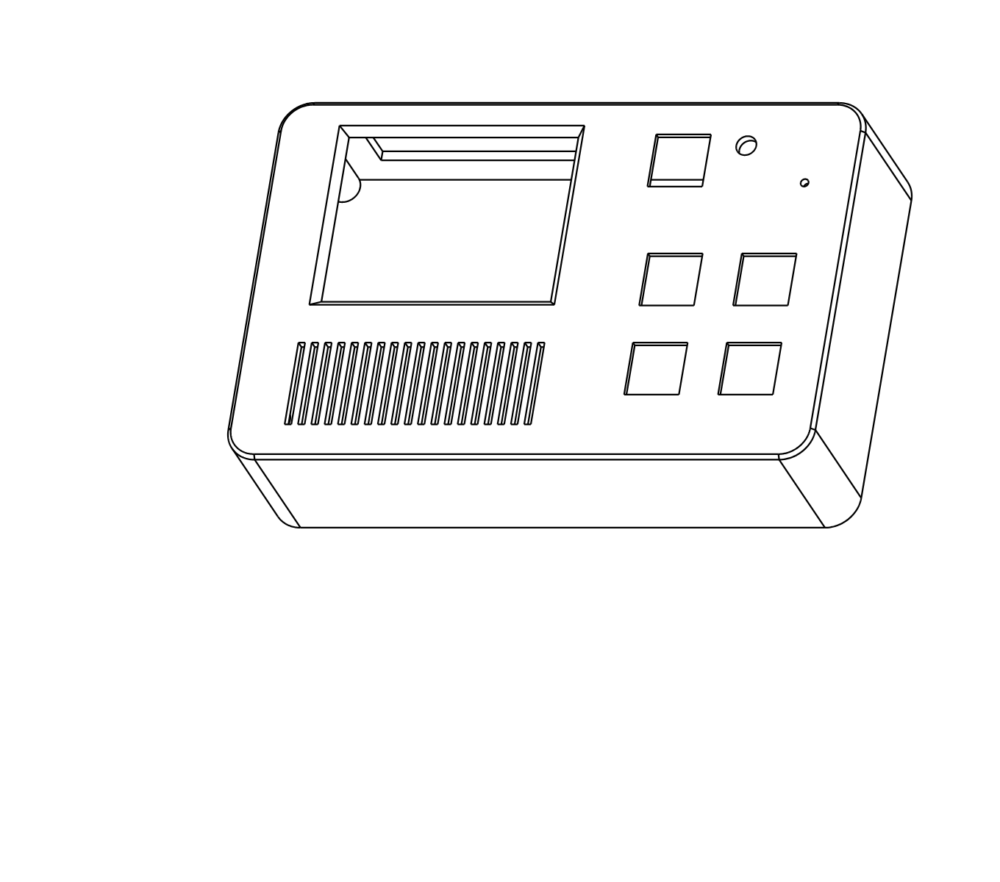
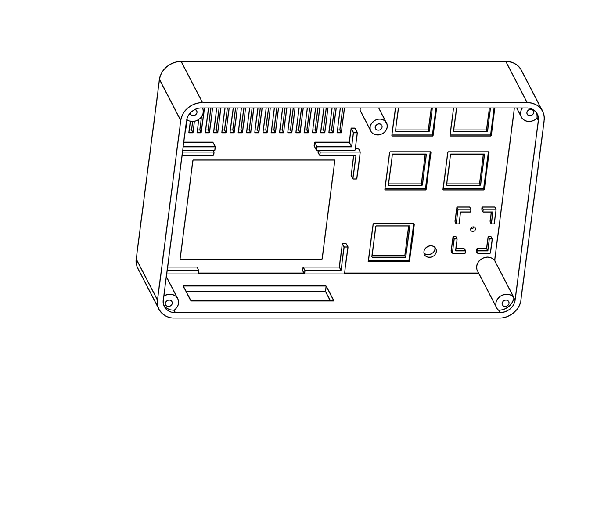
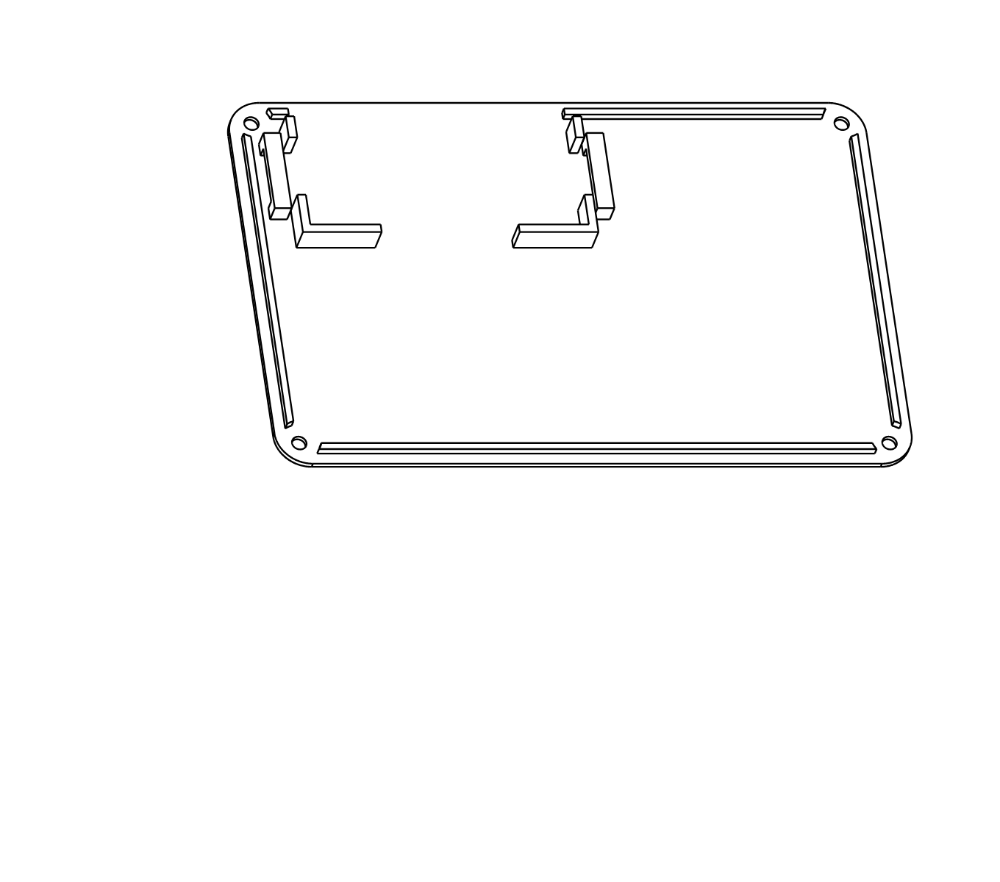
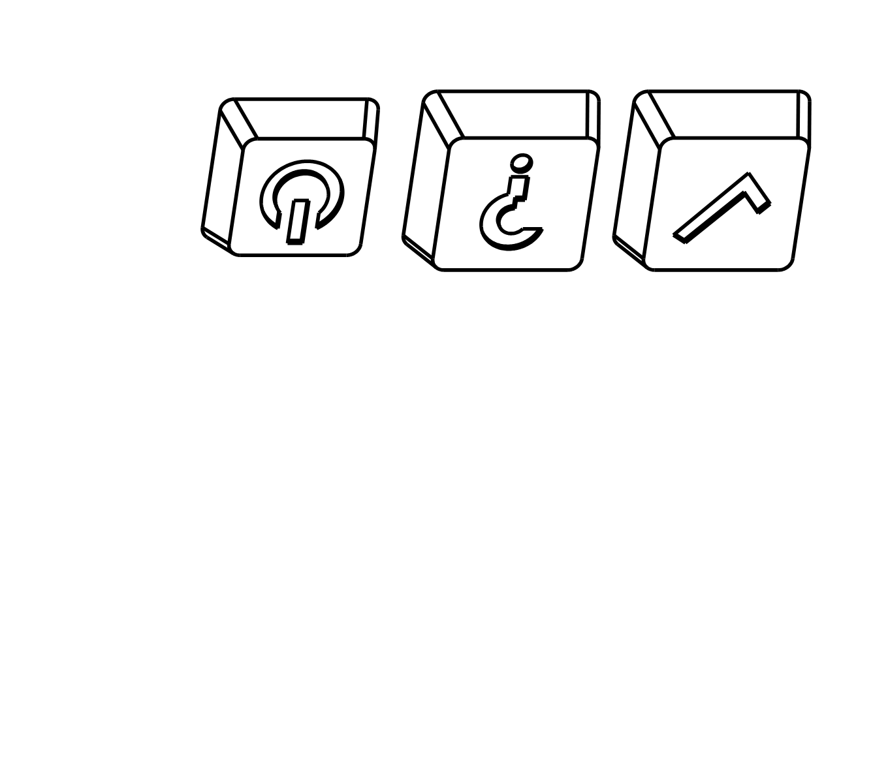

# Building the gostt-guess handheld

A 150 x 96 x 40 mm handheld with a 2.8 inch touch screen, a loud speaker, a
microphone, four big answer keys, a power key and a rechargeable battery,
all inside one printed case.



**Read this first.** Nothing here has been built. The parts were chosen and
the case was drawn from sellers' listings and one maker's 3D model, without
any part in hand. Three things follow from that:

1. Order the parts, then **measure them and print `fit_test` before
   printing the case**. Step 2 below says what to check.
2. The wiring uses one sound-card setting for both the amplifier and the
   microphone that is known from Google's AIY Voice HAT but has not been
   tried with these two boards. Step 5 tests it on the bench before
   anything goes in the case.
3. The program does not draw on the screen yet. The screen is wired and
   mounted so that it is there when the software catches up.

The case is an original design. It does not copy any existing toy.

## Parts

Prices are rough, from late 2026; check them. Sellers other than those
linked carry the same parts.

| # | Part | Why this one | About |
|---|---|---|---|
| 1 | [Raspberry Pi Zero 2 W](https://www.adafruit.com/product/5291), **without** header pins | Runs the speech models. Wires are soldered straight to the board: with header pins and plugs the case would have to be 12 mm thicker. | $15 |
| 2 | microSD card, 32 GB, A1 or A2 rated | | $8 |
| 3 | [PiSugar 3](https://www.tindie.com/products/pisugar/pisugar-3-battery-for-raspberry-pi-zero) (the Pi Zero size, 1200 mAh; also [on Amazon](https://www.amazon.com/PiSugar-Portable-Pwnagotchi-Management-Raspberry/dp/B0FB3N1YSK)) | Battery, USB-C charging and 5 V at up to 2.5 A in one board that screws under the Pi with no soldering. It can shut the Pi down properly when the power key is held, which protects the SD card. | $40 |
| 4 | [Adafruit MAX98357A I2S 3 W amplifier](https://www.adafruit.com/product/3006) | 3.2 W into 4 ohms. | $6 |
| 5 | [Adafruit mono enclosed speaker, 3 W 4 ohm](https://www.adafruit.com/product/3351) | Already in a sealed box, which is most of what makes a small speaker loud. 70 x 30 x 17 mm. | $4 |
| 6 | [Adafruit ICS-43434 I2S microphone](https://www.microcenter.com/quickview/691530/adafruit-industries-i2s-mems-microphone-breakout-ics-43434) (Adafruit product 6049) | The same family as the microphone the sound-card setting was written for. The older [SPH0645 board](https://www.adafruit.com/product/3421) is the same size and should also work. | $5 |
| 7 | [Waveshare 2.8inch Capacitive Touch LCD](https://www.waveshare.com/2.8inch-capacitive-touch-lcd.htm) (240 x 320, ST7789, CST328 touch) | Glass-fronted touch screen with a plain SPI connection and its own cable. | $17 |
| 8 | 5 keyboard switches, Cherry MX style (any: Gateron, Kailh, Cherry), plate mount | Made for millions of presses, snap into a printed hole, two legs to solder. Linear or tactile, not clicky, since the microphone is nearby. | $3 |
| 9 | 5 mm LED, any colour, and a 330 ohm resistor | The "I am listening" light. | $1 |
| 10 | Silicone-insulated stranded wire, 28 or 30 AWG, several colours | Flexible, and the insulation does not melt back when soldered. | $8 |
| 11 | M3 screws: 4 of 12 mm, 2 of 8 mm (pan or button head) | They cut their own thread in the printed holes. | $2 |
| 12 | Hook-and-loop cable tie, 12 mm wide, 150 mm or longer | Holds the Pi and battery to the back cover. | $1 |
| 13 | Double-sided foam tape, 1 mm; thin double-sided tape; hot glue | Mounting. | $5 |
| 14 | USB-C cable and charger | Charging. | |

About $115 before filament.

Also needed: soldering iron, flush cutters, calipers, a computer with an SD
card reader.

## Wiring

Every wire starts at a hole on the Pi's 40-pin header. Pin 1 is the square
pad, nearest the SD card slot; odd pins are the inner row.

| Wire from | To Pi pin | (GPIO) |
|---|---|---|
| **Amplifier** VIN | 2 | 5 V |
| Amplifier GND | 6 | ground |
| Amplifier BCLK | 12 | 18 |
| Amplifier LRC | 35 | 19 |
| Amplifier DIN | 40 | 21 |
| Amplifier + and − | the speaker's two wires | |
| **Microphone** 3V | 1 | 3.3 V |
| Microphone GND | 9 | ground |
| Microphone BCLK | 12, shared with the amplifier | 18 |
| Microphone LRCL | 35, shared with the amplifier | 19 |
| Microphone DOUT | 38 | 20 |
| Microphone SEL | ground (same pad as its GND) | |
| **Yes key** | 11 | 17 |
| **No key** | 13 | 27 |
| **Not sure key** | 15 | 22 |
| **Play key** | 16 | 23 |
| Other leg of all four keys, chained together | 14 | ground |
| **LED** long leg, through the 330 ohm resistor | 37 | 26 |
| LED short leg | 39 | ground |
| **Screen** VCC | 17 | 3.3 V |
| Screen GND | 20 | ground |
| Screen MOSI (DIN) | 19 | 10 |
| Screen SCLK (CLK) | 23 | 11 |
| Screen LCD_CS | 24 | 8 |
| Screen LCD_DC | 22 | 25 |
| Screen LCD_RST | 18 | 24 |
| Screen LCD_BL | 33 | 13 |
| Screen TP_SDA | 3 | 2 |
| Screen TP_SCL | 5 | 3 |
| Screen TP_INT | 7 | 4 |
| Screen TP_RST | 29 | 5 |
| **Power key**, both legs | the PiSugar's "Power Button Pad" and "BAT" pad | not the Pi |

Notes:

- Two wires share pin 12 and two share pin 35. Twist each pair together and
  solder them into the hole as one.
- Leave GPIO 16 (pin 36) empty; the sound-card setting uses it.
- The screen's signals differ from Waveshare's own Raspberry Pi example,
  which puts the backlight on GPIO 18 and reset on GPIO 27. Both are taken
  here, so follow this table.
- The power key bridges two pads on the PiSugar, which its documentation
  describes as doing the same as its own power button. Find them in the
  board diagram in the
  [PiSugar 3 documentation](https://docs.pisugar.com/docs/product-wiki/battery/pisugar3/pisugar-3-series).
  If you would rather not solder to the PiSugar, leave this key out and
  reach its button through the opening in the top edge.
- For more volume, join the amplifier's GAIN pad to GND (12 dB instead of
  9 dB). Try it without first.

Wire lengths, cut generously: screen, keys, LED and microphone 120 mm;
amplifier 80 mm; power key 150 mm. The case opens like a book, with the Pi
on the back cover and everything else on the front, so the wires need that
slack.

## The case

`case/case.py` draws the case; `case/out/` holds the ready-made files, as
STL and as STEP (Bambu Studio opens both).

| File | Count | Print with this side on the plate |
|---|---|---|
| `fit_test` | 1 | front face |
| `front` | 1 | front face |
| `back` | 1 | outside face |
| `speaker_clamp` | 1 | either |
| `keycap_yes`, `keycap_no`, `keycap_not_sure`, `keycap_play`, `keycap_power` | 1 each | top face (flip them over) |





Settings that should suit an H2C: PETG or PLA, 0.2 mm layers, 3 walls, 15%
infill, textured plate. The only place that wants support is the long
opening in the top edge of `front`; paint support there, or accept a slight
sag. With several colours loaded, paint the sunken symbols on the keycaps
in a second colour, and make the yes key green and the no key red. Any
bought MX keycaps fit too.

To change a size, edit the `PARTS` table at the top of `case.py` and run:

```bash
pip install cadquery
```

```bash
python3 case.py
```

## Assembly

### 1. Prepare the SD card

With Raspberry Pi Imager, write **Raspberry Pi OS Lite (64-bit)**. In its
settings, set a user name and password, your Wi-Fi, and turn on SSH.

### 2. Measure, then print the fit test

Check these with calipers against the `PARTS` table in `case.py`, and
correct the table where they differ:

| Check | Expected |
|---|---|
| Screen outline | 73.06 x 50.54 mm |
| Screen: is the lit area centred in the glass? | Assumed yes. If not, set `view_dx` / `view_dy`. |
| Screen thickness, glass to the back of its connector | 8 mm or less |
| Speaker | 70 x 30 x 17 mm |
| Microphone board | 12.7 x 16.7 mm |
| Pi screwed to the PiSugar: battery underside to the top of the Pi's board | 19 mm or less |

Print `fit_test`. The screen, speaker, microphone board, LED and a key
switch should each drop into place without force and without rattling. If
one does not, fix its number and print the test again. Then print the rest.

### 3. Fit the PiSugar

Screw the Pi to the PiSugar as its instructions show, with the SD card in.
Hold the stack up to the opening in the top edge of `front`: the USB-C port
and the PiSugar's lights should show through it. The opening is wide
because the port's exact position was not known; it can be narrowed in
`case.py` once you have seen where it is.

### 4. Solder

Solder wires to the modules first, then to the Pi, following the wiring
table. Insert each wire from the top of the Pi (the side with the chips),
solder on that side too, and lay the wire flat towards the middle of the
board. Keep joints low: there are about 7 mm between the Pi and the back of
the screen.

Snap the five switches into the front from outside before soldering their
legs. Chain one leg of the four answer keys together with short wire links.

### 5. Test on the bench, before closing anything

Power on (tap, then hold, the PiSugar's power button), connect with SSH,
and follow [the install steps](../README.md#install). Then add to
`/boot/firmware/config.txt`:

```
dtparam=i2c_arm=on
dtparam=spi=on
dtoverlay=googlevoicehat-soundcard
```

Reboot. `aplay -l` and `arecord -l` should both list the same new card. Put
its name in `/etc/gostt-guess/config.yaml`:

```yaml
audio:
  capture: "arecord -q -D plughw:CARD=sndrpigooglevoi,DEV=0 -f S16_LE -r 16000 -c 1 -t raw"
  play: "aplay -q -D plughw:CARD=sndrpigooglevoi,DEV=0 -t raw -f S16_LE -c 1 -r {rate}"
  gain: 8
```

Then work through
[Test it, one part at a time](../README.md#test-it-one-part-at-a-time).
`gostt-guess check` tests the speaker and microphone and says how to set
`gain`; `gostt-guess check -buttons 20s` tests the keys.

If the card plays but does not record, or the reverse, that is the untested
part of this design. The fallback is a small USB sound adapter on the Pi's
USB port; tell me what `arecord -l` and `dmesg | grep -i voicehat` print.

Install the PiSugar's software so that holding the power key shuts the Pi
down cleanly:

```bash
wget https://cdn.pisugar.com/release/pisugar-power-manager.sh
```

```bash
bash pisugar-power-manager.sh -c release
```

Choose `PiSugar3`, then open `http://<the Pi's address>:8421` and set the
power button's long press to shut down.

### 6. Mount everything

Front:

1. Screen: thin double-sided tape on the black border of the glass, then
   press it into its corner ribs, cable towards the middle of the case.
2. Speaker: into its pocket with the cone towards the slots, then the clamp
   across its back with the two 8 mm screws. Snug, not tight.
3. Microphone: into its small pocket with the hole in the board over the
   hole in the case, held by a dab of hot glue at two corners. Keep glue
   away from the hole.
4. LED: into its hole, with a dab of hot glue behind.
5. Amplifier: foam tape, on the inside of the front beside the keys.
6. Keycaps on.

Back cover:

1. Foam tape on the battery, then press the stack into its two corner ribs
   with the ports towards the top edge.
2. Thread the hook-and-loop tie under the two small bridges and over the
   Pi, lengthwise, and close it.

Close the case like a book, check no wire is pinched and that the charging
port lines up with its opening, and fit the four 12 mm screws. They cut
their own thread: turn until snug and stop.

Finally: `sudo systemctl enable --now gostt-guess`.

## What is known and not known

| | |
|---|---|
| The printed parts are valid single solids and their features line up with each other | Checked in the CAD model |
| The parts fit the case | **Not checked.** Sizes are from listings; the screen's thickness, the position of its lit area and the PiSugar's port position are assumptions. That is what `fit_test` and step 3 are for. |
| Amplifier and microphone on one sound card | **Not checked** with these boards |
| Battery life | Not measured. A 1200 mAh cell is about 4 Wh; expect an hour or two of play. |
| Loudness | Not measured |
| The keycaps' stems grip the switches | Not checked; printed stems often need a tolerance tweak (`cross` in `keycap`) |
| Screen | Wired and mounted; the software does not use it yet |
