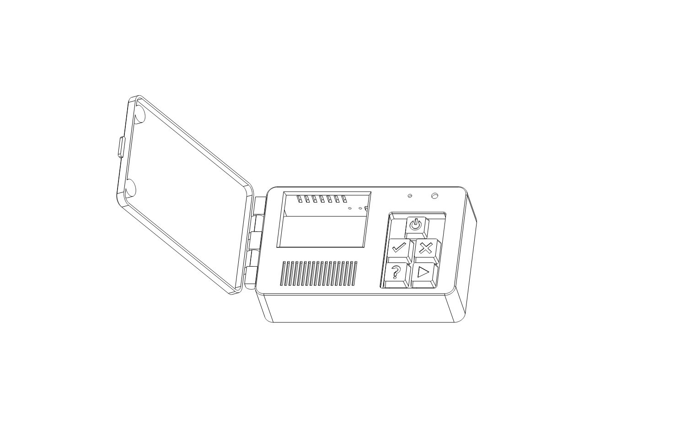
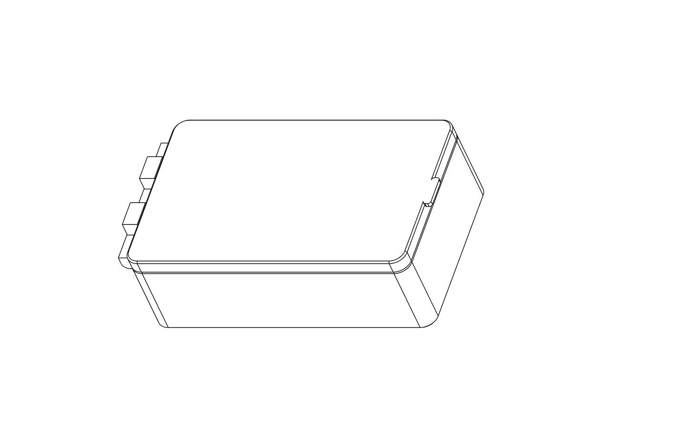
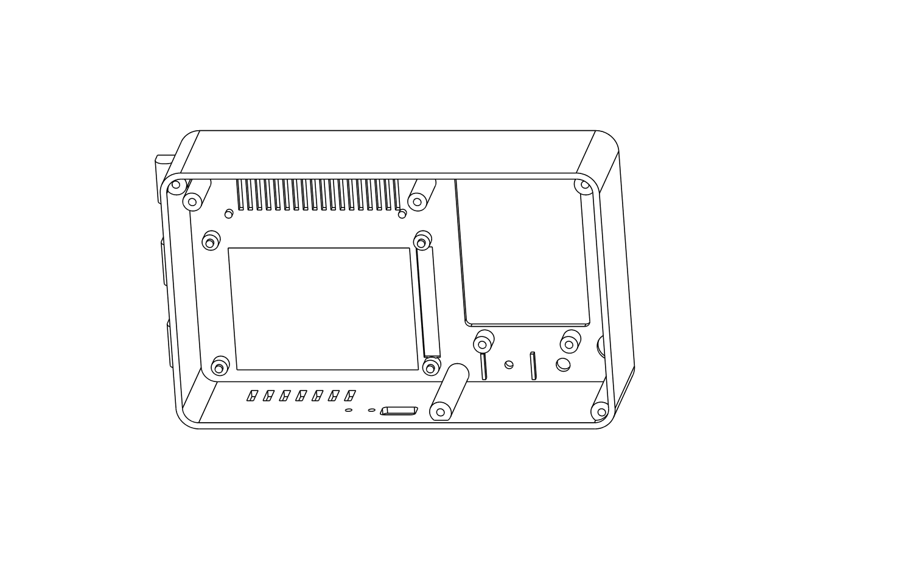

# Building the gostt-guess handheld

A hinged handheld, 162 x 100 mm and 53 mm thick when closed. Inside: a
Raspberry Pi 4, a 5000 mAh battery board, a 2.8 inch touch screen, a 3 W
speaker, a microphone and five keys. The lid is held shut by magnets.



**Status.** Nothing here has been built. What has changed since the first
version is where the numbers come from: the case is now drawn from the
makers' own CAD and board files, and checked for collisions against those
models (`case/check_fit.py`). What that cannot cover is listed, item by
item, under [What is established and what is not](#what-is-established-and-what-is-not).
No remote design can be free of unknowns; this one names each and leaves
slack for it.

The case is an original design, not a copy of an existing toy.

## Why these parts

| Requirement | Choice | Basis |
|---|---|---|
| Speech recognition in real time | Raspberry Pi 4 Model B, 2 GB | The speech library's documentation states its models run in real time on a Pi 4. Scaling a benchmark of this exact model gives about a third of real time on one core, and 290 MB of memory with the voice loaded too. Nothing comparable is published for the Pi Zero 2 W, where estimates range from half of real time to slower than real time. |
| Several hours of battery | PiSugar 3 Plus, 5000 mAh | 18.5 Wh. The budget below comes to about 3.8 W, so about 4 hours (3.5 to 5). The earlier 1200 mAh choice gave about 2. |
| Loud | MAX98357A amplifier, 3.2 W into the 4 ohm enclosed speaker | The alternatives with a microphone built in (WM8960 boards) give about 1 W. |
| Microphone | ICS-43434 I2S board | Uses the same sound-card driver as the amplifier. |
| Screen | Adafruit PiTFT Plus 2.8" capacitive | Its driver is part of Raspberry Pi OS, it plugs onto the Pi with no wiring, and Adafruit publishes its board files and 3D model. The Waveshare screen chosen before has no driver in Raspberry Pi OS. |
| Buttons | 5 keyboard switches | Rated for millions of presses; big caps for small hands. |
| Storage | 32 GB microSD | The system and both speech models need under 4 GB. |
| No power-off damage | PiSugar's shutdown on a held power key, and at low battery | From PiSugar's documentation. |

Power budget: Pi 4 idle 2.7 W and about 0.9 W more per busy core
(published measurements); recognition busy about half the time, 0.5 W;
backlight 0.36 W (from the display's circuit); amplifier averaging 0.15 W
on speech. The peak, about 2.1 A at 5 V, is inside the PiSugar's 3 A.

## Parts

| # | Part | Link |
|---|---|---|
| 1 | Raspberry Pi 4 Model B, 2 GB | [raspberrypi.com](https://www.raspberrypi.com/products/raspberry-pi-4-model-b/) |
| 2 | PiSugar 3 Plus (5000 mAh, for Pi 3B/4B) | [Tindie](https://www.tindie.com/products/pisugar/pisugar-3-plus-battery-for-raspberry-pi-3b3b4b/) |
| 3 | Adafruit PiTFT Plus 2.8" capacitive touch, product 2423 | [adafruit.com/product/2423](https://www.adafruit.com/product/2423) |
| 4 | Adafruit MAX98357A I2S 3 W amplifier, product 3006 | [adafruit.com/product/3006](https://www.adafruit.com/product/3006) |
| 5 | Adafruit mono enclosed speaker 3 W 4 ohm, product 3351 | [adafruit.com/product/3351](https://www.adafruit.com/product/3351) |
| 6 | Adafruit ICS-43434 I2S microphone, product 6049 | [Micro Center](https://www.microcenter.com/quickview/691530/adafruit-industries-i2s-mems-microphone-breakout-ics-43434) |
| 7 | microSD card, 32 GB, A1 or A2 | |
| 8 | 5 keyboard switches, Cherry MX style, plate mount, not clicky | |
| 9 | 5 mm LED and a 330 ohm resistor | |
| 10 | Silicone-insulated stranded wire, 28 or 30 AWG | |
| 11 | 3 mm metal rod, 80 mm long (hinge pin) | |
| 12 | M3 screws, pan or button head: 4 of 12 mm, 4 of 8 mm | |
| 13 | Soft foam pad, 3 mm thick; thin double-sided tape; superglue; hot glue | |
| 14 | 4 of your 10 x 1.5 mm magnets | |

I could not check prices or stock from here. Expect roughly $200 in total,
most of it the Pi, the battery board and the screen.

An optional camera is not designed in. A Raspberry Pi Camera Module 3
connects to a Pi 4 with the cable it comes with, but its mount, a lens
opening and whether its cable clears the screen board have not been worked
out.

## Wiring

The screen board plugs onto the Pi's 40 pins, and the battery board
presses against the Pi from underneath. Neither needs soldering.

Everything else is soldered to the **screen board**: its socket's 40 solder
joints are exposed on the screen side, in the 6 mm strip beside the
display. Each joint sits directly above the Pi pin of the same number: pin
1 is at the SD card end, and odd pins are the row nearer the display.
Tin the wire, hold it on the joint and reflow.

| Wire from | To pin | (GPIO) |
|---|---|---|
| **Amplifier** VIN | 2 | 5 V |
| Amplifier GND | 6 | ground |
| Amplifier BCLK | 12 | 18 |
| Amplifier LRC | 35 | 19 |
| Amplifier DIN | 40 | 21 |
| Amplifier + and − | the speaker's two wires | |
| **Microphone** 3V | 1 | 3.3 V |
| Microphone GND | 9 | ground |
| Microphone BCLK | 12, with the amplifier's | 18 |
| Microphone LRCL | 35, with the amplifier's | 19 |
| Microphone DOUT | 38 | 20 |
| Microphone SEL | its own GND pad | |
| **Yes key** | 11 | 17 |
| **No key** | 13 | 27 |
| **Not sure key** | 15 | 22 |
| **Play key** | 16 | 23 |
| Other leg of those four keys, chained | 14 | ground |
| **LED** long leg, through the 330 ohm resistor | 37 | 26 |
| LED short leg | 39 | ground |
| **Power key**, both legs | the PiSugar's "Power Button Pad" and "BAT" pad | not the Pi |

The screen itself uses GPIO 8 to 11, 24 and 25 and the I2C pins, which the
battery board shares. GPIO 16 is driven by the sound driver; leave pin 36
alone. The four key GPIOs are also wired to four tiny switches on the edge
of the screen board, which the case covers; they do no harm.

**One cut is needed on the screen board.** A small closed jumper connects
GPIO 18 to the backlight, and GPIO 18 is the audio clock here. It is on the
underside, about 17 mm in from the long edge with the socket and 30 mm from
the short edge with the four tiny switches. Cut the thin bridge between its
two pads with a knife. In the circuit the backlight is switched on by a
pull-up and GPIO 18 can only pull it off through a diode, so after the cut
it should simply stay on; I have read that from the schematic, not seen it.

The power key bridges two pads that PiSugar's documentation says act as its
power button; its board diagram shows where they are. If you would rather
not solder to the battery board, skip it: two pin holes in the top edge of
the case line up with the board's own two buttons.

Wire lengths: all about 120 mm. Every wired part mounts in the same half of
the case as the screen board, so nothing crosses a joint.

## The case

`case/case.py` draws it; `case/out/` has every piece as STL and STEP.

| Piece | Colour | Side on the plate |
|---|---|---|
| `fit_test` | any | front face |
| `front` with `front_inlay` | body colour, accent | front face |
| `lid` with `lid_inlay` | body colour, accent | outside face |
| `back` | body colour | outside face |
| `deck` | dark | flat plate |
| `speaker_clamp` | any | either |
| `keycap_*` with `keymark_*` (5 pairs) | one colour per key, contrasting mark | top face |




Each `_inlay` and `keymark_` file shares its partner's position. In Bambu
Studio, select both files, import them as one object with multiple parts,
and give each part its filament. With body, accent, dark and four cap
colours this is a seven-colour job, which is what an H2C is for; with
fewer, print the caps separately.

PETG or PLA, 0.2 mm layers, 3 walls, 15% infill. No supports are needed.

**Magnets.** Two sit in pockets on the inside of `front`, glued in after
printing; the back cover and the body shut them away. Two go in the `lid`,
inside closed pockets: add a pause at 7.1 mm, drop each magnet in with a
drop of superglue, and resume. Before that, stack each lid magnet on its
partner in the body to find which face must point at it, and mark it. The
pockets are closed on purpose: loose magnets of this size are dangerous if
a child swallows two. For the same reason the back cover is held by screws,
not magnets.

**Hinge.** Three knuckles on the body, two on the lid, and a 3 mm rod. The
lid's holes are 3.4 mm and turn freely; the body's are 3.0 mm and grip.
Run a 3 mm drill through the body's knuckles if the rod will not start.

To change anything, edit the numbers at the top of `case.py` and run:

```bash
pip install cadquery
```

```bash
python3 case.py
```

## Assembly

### 1. Print the fit test and try the parts

`fit_test` is the front 8 mm of the body. Check:

- The screen board drops onto its four pins, glass down, and the display
  fills the window.
- The speaker sits on its four pegs.
- The microphone board fits between its two ribs with its hole over the
  hole in the case.
- The LED fits its hole; a magnet fits its pocket.

Print `deck` too and snap a switch in. If anything is off, tell me the
measurement or change it in `case.py`. Then print the rest.

### 2. Prepare the SD card

Raspberry Pi Imager, **Raspberry Pi OS Lite (64-bit)**. In its settings set
a user and password, Wi-Fi, and turn on SSH.

### 3. Test the electronics on the bench

1. Cut the backlight jumper on the screen board.
2. Screw the PiSugar under the Pi, as its instructions show.
3. Solder the amplifier, speaker, microphone, keys and LED to the screen
   board, then plug it onto the Pi.
4. Power on, connect with SSH and follow
   [the install steps](../README.md#install).
5. Add to `/boot/firmware/config.txt`, then reboot:

```
dtparam=i2c_arm=on
dtparam=spi=on
dtparam=audio=off
dtoverlay=googlevoicehat-soundcard
dtoverlay=pitft28-capacitive,rotate=270,speed=32000000,fps=25
```

   If the picture is upside down, change `rotate=270` to `rotate=90`.

6. Put the sound card in `/etc/gostt-guess/config.yaml`:

```yaml
audio:
  capture: "arecord -q -D plughw:CARD=sndrpigooglevoi,DEV=0 -f S16_LE -r 16000 -c 1 -t raw"
  play: "aplay -q -D plughw:CARD=sndrpigooglevoi,DEV=0 -t raw -f S16_LE -c 1 -r {rate}"
  gain: 8
```

7. Work through
   [Test it, one part at a time](../README.md#test-it-one-part-at-a-time).
   Then play a game with `gostt-guess -buttons=false -debug` and check
   that each reply registers within about a second of being spoken.
8. Install the battery board's software and set a long press of the power
   key to shut down:

```bash
wget https://cdn.pisugar.com/release/pisugar-power-manager.sh
```

```bash
bash pisugar-power-manager.sh -c release
```

Choose `PiSugar3`, then open `http://<the Pi's address>:8421`.

Do not close the case until all of this works.

### 4. Build it into the case

1. Glue the two body magnets into their pockets on the inside of `front`.
2. Snap the five switches into `deck` from above. Screw the deck to its
   two posts inside the front with 8 mm screws. Fit the keycaps.
3. Speaker onto its pegs, sound side to the slots; clamp across its back
   with two 8 mm screws.
4. Microphone between its ribs, hole to hole, with hot glue at two corners
   only. LED into its hole with hot glue behind.
5. Amplifier: foam tape, under the key deck.
6. Lower the Pi stack in, screen first, onto the four pins. The charging
   port should show in the opening in the top edge.
7. Lay the foam pad on the battery. Fit the back cover with the four
   12 mm screws until snug.
8. Line up the lid's knuckles and push the rod through.

Finally: `sudo systemctl enable --now gostt-guess`.

## What is established and what is not

Established from the makers' own files (the display board's CAD and board
layout, the speaker, microphone and amplifier CAD, the PiSugar 3 Plus CAD
and PiSugar's own case for it, the Linux sound driver's source):

- Every printed piece is a valid solid, and none collides with the
  display board, the speaker, the battery board, the space PiSugar's own
  case allows for the battery, or the key switches and caps, with the lid
  closed.
- The display board's mounting holes, display outline and socket position;
  the speaker's flange holes; the charging port's position, which lines up
  with its opening.
- The sound driver has playback and recording on one device, at 48 kHz.
  Adafruit's installers for this amplifier and for this microphone family
  both select it.
- The screen's driver and its `pitft28-capacitive` setting are part of
  Raspberry Pi OS.

Not established, and what the design does about each:

| Unknown | Consequence | Provision |
|---|---|---|
| Speed on a real Pi 4. The basis is the library's own statement and a scaled benchmark, not a measurement of this program. | If slower than expected, replies lag. | Step 3 tests it before the case is closed. `hear.threads` and `hear.decoding` are the adjustments. |
| Amplifier and microphone working at the same moment on one driver. Each direction is documented; I found no page showing both together. | If not, one of them needs a USB sound adapter. | Step 3 tests it first. |
| Whether the model understands your child. | Asks again more often. | The keys answer every question. |
| The battery's real thickness. The case uses the 11.1 mm that PiSugar's own case leaves. | Back cover would not close, or the stack would be loose. | 2 mm of slack filled by the foam pad; `FOAM` in `case.py`. |
| How far the Pi 4's sockets overhang its board. Raspberry Pi's drawing could not be opened from here. | A wall could foul a socket. | 4 mm and 3.5 mm of clearance, more than any of them needs. |
| Height of the four tiny switches on the screen board; the CAD model places them oddly. | The front could press on them. | A relief 5.4 mm high; they are 5.0 in the model. |
| That the backlight stays on after the jumper is cut. | Dark screen. | Bridge the jumper again with solder; the screen then dims while sound plays. |
| Where the lit area sits within the display. | Cosmetic: an uneven black border. | The window shows the whole display. |
| Real battery life, loudness, and temperature inside a closed case. | | Vents in the top edge and back; the Pi slows itself down before it overheats. |
| Print fits: keycap stems, hinge, magnet pockets, magnet strength through 1.7 mm. | Loose or tight. | `fit_test`; all are single numbers in `case.py`. |
| Anything on the screen. | The program does not draw on it yet. | Next piece of software. |

To rerun the collision check, download `2423.step`, `3351.step` (from
github.com/adafruit/Adafruit_CAD_Parts) and `pisugar3plus.STEP` as
`ps3plus.step` (from github.com/PiSugar/PiSugar, folder `model_pro`) into a
folder and run `python3 case/check_fit.py <folder>`.
